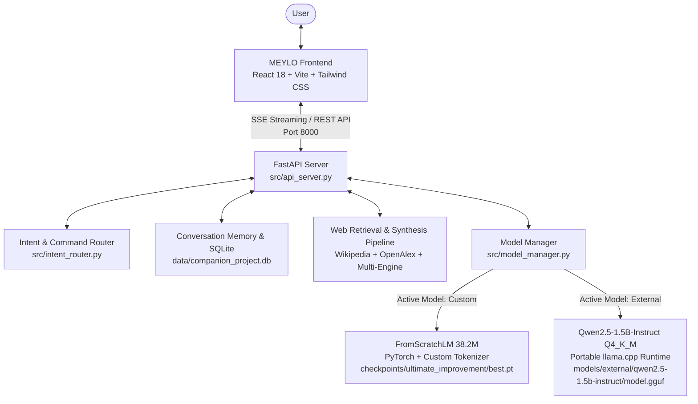

# MEYLO — Your AI. Your Space.

<p align="center">
  <strong>A Full-Stack Local AI Companion with Custom Deep Learning Architecture & Modern Web Experience</strong>
</p>

<p align="center">
  
  
  
  
</p>

---

## Overview

**MEYLO** is an end-to-end, privacy-first personal AI companion built from the ground up. It seamlessly bridges custom deep learning research with a production-grade web application:

- **Custom Trained Language Model (`FromScratchLM`)**: A 38.2M parameter Transformer decoder trained from scratch on curated dialogue and educational corpora.
- **Local External Model (`Qwen2.5-1.5B-Instruct`)**: A high-efficiency reasoning engine running locally via an embedded `llama.cpp` runtime.
- **Independent Dual-Engine Orchestrator**: Explicit model switching with zero silent delegation or cross-model bleed.
- **Real-Time Streaming Interface**: ChatGPT-grade web experience featuring real-time Server-Sent Events (SSE), hardware telemetry, conversation management, and verified web citations.
- **100% Local & Private**: All conversations, embeddings, weights, and memories remain strictly on your local machine.

---

## System Architecture



---

## Dual Model Engine

MEYLO features a strictly separated dual-engine architecture:

| Attribute | Custom Model (`FromScratchLM`) | External Model (`Qwen2.5-1.5B`) |
| :--- | :--- | :--- |
| **Origin** | Trained from scratch | Pretrained open weights (Q4_K_M) |
| **Parameters** | 38.2 Million (Float32 / BFloat16) | 1.54 Billion (4-bit quantized) |
| **Tokenizer** | Custom Byte-Pair Encoding (16,384 vocab) | Qwen BPE (151,936 vocab) |
| **Strengths** | Emotional companion, empathy, active listening, casual banter | Complex reasoning, mathematics, Python coding, long analysis |
| **Memory Footprint** | ~162 MB VRAM / RAM | ~1.1 GB RAM / VRAM |
| **Latency** | Ultra-low (<50ms first-token) | Fast (~30-40 tokens/sec on CPU/GPU) |

---

## Features

- **Real-Time Token Streaming**: Smooth, responsive streaming via Server-Sent Events (SSE).
- **Live Hardware Telemetry**: Live CPU, System RAM, GPU, and VRAM monitors displayed right inside the header.
- **Dynamic Web Search**: Multi-provider retrieval (Wikipedia REST API, OpenAlex Academic API, and privacy-focused search) with verifiable citations and source links.
- **Persistent Memory**: Structured SQLite storage tracking conversations, message branches, model selection, and timing.
- **Interactive Slash Commands**:
  - `/help`: Comprehensive command directory and usage tips.
  - `/clear`: Wipe active conversation context.
  - `/model <custom|external>`: Hot-swap active inference engine.
  - `/search <query>`: Execute targeted web retrieval.
  - `/status`: Inspect active model and runtime health.
  - `/stats`: Display hardware and conversation statistics.
  - `/memory`: Review active short-term and persistent memory.
- **Dark & Light Mode**: Modern UI tailored for comfort across all screen sizes.

---

## Directory Structure

```
DEEP-LEARNING-PROJECT/
├── START_MEYLO.bat          # One-click launcher (backend + frontend)
├── STOP_MEYLO.bat           # Graceful shutdown script
├── PROJECT_MEYLO.md         # Comprehensive 1,000+ line technical specification
├── requirements.txt         # Python backend dependencies
├── checkpoints/             # Trained PyTorch weights for FromScratchLM
│   └── ultimate_improvement/
│       └── best.pt          # Active 38.2M model checkpoint
├── data/                    # Datasets, SQLite database, and capability metadata
│   ├── companion_project.db # Persistent conversation and training database
│   └── verified_model_capabilities.json
├── frontend/                # React 18 + TypeScript + Tailwind CSS application
│   ├── src/                 # UI components, state stores, and API clients
│   ├── package.json
│   └── vite.config.ts
├── models/
│   └── external/
│       └── qwen2.5-1.5b-instruct/  # External GGUF model and configs
├── runtime/
│   └── llama.cpp/           # Portable, self-contained llama.cpp binaries
├── src/                     # Backend Python source code
│   ├── api_server.py        # FastAPI REST & SSE streaming server
│   ├── model.py             # FromScratchLM PyTorch architecture
│   ├── model_manager.py     # Independent dual-engine orchestrator
│   ├── companion_database.py# SQLite WAL memory engine
│   └── web_retrieval.py     # Multi-source web search & synthesis
├── tests/                   # Automated regression and verification test suites
└── tokenizer/               # Custom BPE tokenizer (tokenizer.json)
```

---

## Quick Start

### 1. Prerequisites
- **Operating System**: Windows 10/11, Linux, or macOS.
- **Python**: Version 3.10, 3.11, or 3.12.
- **Node.js**: Version 18+ (for frontend development/build).

### 2. Setup Backend Environment

```bash
# Clone the repository
git clone https://github.com/<your-username>/meylo.git
cd meylo

# Create and activate virtual environment
python -m venv .venv
# On Windows:
.venv\Scripts\activate
# On Linux/macOS:
source .venv/bin/activate

# Install dependencies
pip install -r requirements.txt
```

### 3. Setup Frontend

```bash
cd frontend
npm install
npm run build
cd ..
```

### 4. Model Weights Placement

- **Custom Model**: Ensure your trained checkpoint is located at:
  ```
  checkpoints/ultimate_improvement/best.pt
  ```
- **External Model**: Download `qwen2.5-1.5b-instruct-q4_k_m.gguf` from [Hugging Face](https://huggingface.co/Qwen/Qwen2.5-1.5B-Instruct-GGUF) and place it at:
  ```
  models/external/qwen2.5-1.5b-instruct/model.gguf
  ```

### 5. Launch Application

On Windows, simply double-click:
```cmd
START_MEYLO.bat
```
This automatically launches the FastAPI backend on port 8000, starts the web frontend on port 5173, and opens your browser.

To stop all services:
```cmd
STOP_MEYLO.bat
```

---

## Verification & Testing

MEYLO includes comprehensive automated verification suites:

```bash
# Verify backend API endpoints and SSE streaming
.venv\Scripts\python.exe tests/test_frontend_api_integration.py

# Run comprehensive regression and capability tests
.venv\Scripts\python.exe tests/test_master_directive_regression_suite.py
```

---

## Documentation

For an exhaustive, academic-grade breakdown of the Transformer math, BPE tokenizer implementation, training curriculum, and hardware benchmarks, please see:
- [PROJECT_MEYLO.md](PROJECT_MEYLO.md) — Complete 1,000+ line technical architecture & development report.

---

## License

This project is licensed under the MIT License. See [LICENSE](LICENSE) for details.
